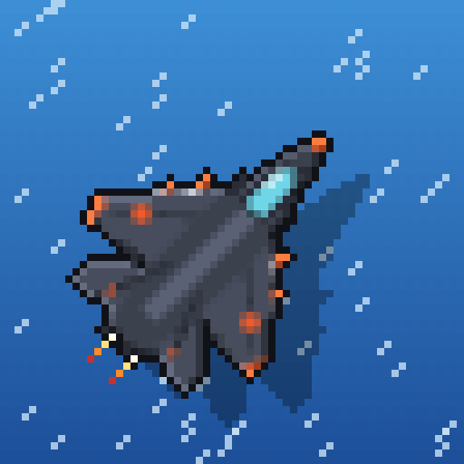

<div align="center">

# cloud-fighters

[](https://verhaeg.github.io/cloud-fighters/)
[](https://github.com/Verhaeg/cloud-fighters)



_a pixel-art dogfight in one html file: 360° flight, guns, missiles, mountains and a day that turns into night._

</div>

play in the browser (on iPad, share → add to home screen for fullscreen and offline):

```bash
open https://verhaeg.github.io/cloud-fighters/
```

run locally:

```bash
git clone https://github.com/Verhaeg/cloud-fighters.git
cd cloud-fighters
python3 -m http.server 8765   # then open http://localhost:8765
```

| action            | keyboard                  | touch               |
| ----------------- | ------------------------- | ------------------- |
| turn              | A / D, ← / →              | left-side joystick  |
| climb / descend   | W / S, ↑ / ↓              | ▲ Subir / ▼ Descer  |
| machine gun       | Space, J, left click      | Fogo                |
| missile           | E, K, right click         | Míssil              |
| turbo, hard turn  | Shift (while turning)     | Turbo               |
| up & break        | Q                         | Freio               |
| loop              | R                         | Loop                |
| switch view       | V                         | Visão               |
| time +2 h         | T                         | Hora +2             |

<sub>font: [Silkscreen](https://fonts.google.com/specimen/Silkscreen) by the Silkscreen Project Authors, SIL Open Font License 1.1 (see `fonts/OFL.txt`).</sub>
